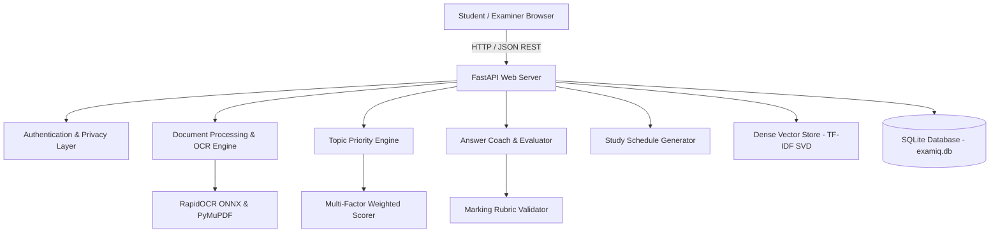

# ExamIQ System Architecture

ExamIQ is engineered using a decoupled, high-performance architecture split across a modern **React + Vite** frontend and a modular **FastAPI** backend, backed by local machine learning algorithms and persistent relational storage.

## 1. Architectural Layers

### A. Presentation Layer (Frontend)
- **Framework**: React 18 with TypeScript and Vite.
- **Styling**: Tailwind CSS v4 with custom dark/light theme tokens and glassmorphism.
- **Icons**: Lucide React.
- **State & Data**: Centralized asynchronous API client with JWT session synchronization and reactive cache invalidation.

### B. Application & API Layer (Backend)
- **Framework**: FastAPI (Python 3.10+ / 3.13 tested).
- **Security**: JWT bearer authentication using `pyjwt` and password hashing with `bcrypt`.
- **Validation**: Strict schema validation using Pydantic v2.
- **Persistence**: SQLAlchemy 2.0 ORM with SQLite database (`data/examiq.db`).

### C. Document Intelligence & OCR Pipeline
- **Native Extraction**: PyMuPDF (`fitz`) handles rapid page parsing and vector layout analysis.
- **Selective OCR**: For scanned notes and handwritten documents, the engine activates `rapidocr-onnxruntime`. This provides pure-Python/ONNX execution on CPU with zero reliance on system Tesseract binaries.
- **Heuristic Handwriting Detector**: Analyzes page token density, word bounding box variance, and OCR character confidence to flag handwritten or low-confidence pages.

### D. Semantic Search & Vector Engine
- **Embedding Generation**: 128-dimensional dense vector embeddings generated via `TfidfVectorizer` and `TruncatedSVD`.
- **Vector Index**: In-memory cosine similarity search with automatic self-healing rehydration from SQLite chunk records.

### E. Privacy & Role Separation
- **Student Profile**: Individual marks, weak areas, and notes are strictly confidential to the authenticated student.
- **Admin Dashboard**: Faculty/admin views only expose aggregate analytics, document inventory status, and anonymized HCI metrics.
