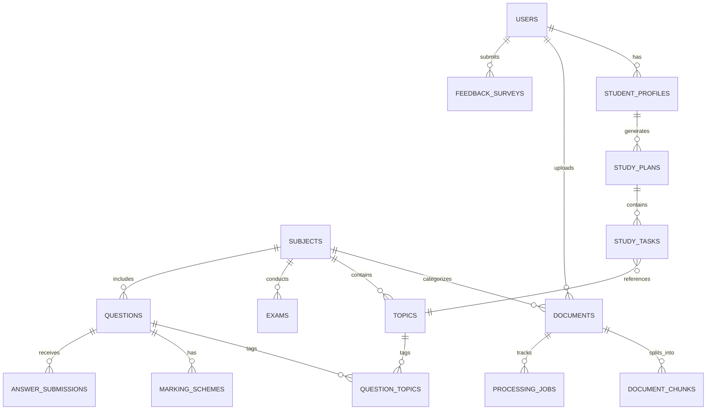

# ExamIQ Database Schema & Data Dictionary

ExamIQ persists all state in a normalized relational database using **SQLAlchemy 2.0 ORM** and **SQLite** (`data/examiq.db`).

---

## 1. Entity-Relationship Overview

---

## 2. Core Tables Specification

### 1. `users`
| Column | Type | Constraints | Description |
| :--- | :--- | :--- | :--- |
| `id` | Integer | PK, Auto-increment | Unique user identifier |
| `email` | String(255) | Unique, Indexed, Not Null | Account email |
| `hashed_password` | String(255) | Not Null | Bcrypt salted hash |
| `full_name` | String(255) | Not Null | User's display name |
| `role` | Enum | `STUDENT`, `ADMIN` | Role-based authorization |
| `is_active` | Boolean | Default True | Account activation status |
| `created_at` | DateTime | Server default UTC | Timestamp of creation |

### 2. `student_profiles`
| Column | Type | Constraints | Description |
| :--- | :--- | :--- | :--- |
| `id` | Integer | PK, Auto-increment | Unique profile ID |
| `user_id` | Integer | FK(`users.id`), Unique | Owner user reference |
| `subject_id` | Integer | FK(`subjects.id`), Nullable | Active subject under preparation |
| `target_marks` | Float | Default 85.0 | Target score percentage |
| `available_hours_per_day` | Float | Default 3.0 | Daily dedicated study hours |
| `exam_date` | Date | Default 2026-11-15 | Scheduled university exam date |
| `completed_topics` | JSON | Default `[]` | List of completed topic names |
| `weak_topics` | JSON | Default `[]` | Self-reported or inferred weak areas |
| `strong_topics` | JSON | Default `[]` | Verified high-confidence topics |
| `previous_marks` | Float | Default 72.0 | Previous semester/internal baseline |
| `overall_readiness` | Float | Default 68.0 | Composite readiness percentage |

*Privacy Guarantee: The `student_profiles` table is strictly confidential. Only the owning authenticated user can read or modify their profile; admin endpoints only aggregate anonymous counts.*

### 3. `documents` & `document_chunks`
- **`documents`**: Ingested course materials, lecture notes, handwritten sheets, and PYQs.
  - Fields: `subject_id`, `filename`, `file_path`, `file_type`, `doc_category` (`LECTURE_NOTES`, `HANDWRITTEN_NOTES`, `QUESTION_PAPER`, `SYLLABUS`, `REFERENCE_MATERIAL`), `page_count`, `status`, `classification_confidence`, `ocr_used`, `ocr_confidence`, `is_handwritten`.
- **`document_chunks`**: Paragraph and page-level text segments.
  - Fields: `document_id`, `page_number`, `chunk_index`, `content`, `chunk_type` (`text`, `handwritten`, `diagram_caption`, `formula`), `embedding_id`.

### 4. `topics`
- Represents course concepts evaluated by the Priority Engine.
  - Fields: `name`, `category`, `syllabus_weight`, `historical_frequency`, `avg_marks`, `preparation_priority` (`HIGH`, `MEDIUM`, `LOW`), `priority_score`, `priority_breakdown` (JSON), `keywords` (JSON), `algorithms` (JSON), `formulas` (JSON), `recommended_study_minutes`.

### 5. `questions` & `marking_schemes`
- **`questions`**: Extracted or verified past questions.
  - Fields: `question_number`, `text`, `marks`, `question_types` (JSON: `Calculation`, `Diagram`, `Algorithm`, `Comparison`, `Descriptive`), `estimated_difficulty`, `requires_diagram`, `requires_calculation`, `requires_algorithm`, `academic_year`, `is_pyq`.
- **`marking_schemes`**: Mark allocation criteria breakdown for Answer Coach.
  - Fields: `question_id`, `criteria` (JSON: step description, allotted marks, mandatory keywords).

### 6. `study_plans` & `study_tasks`
- **`study_plans`**: Multi-day dynamic schedules.
  - Fields: `student_profile_id`, `subject_id`, `exam_date`, `total_days`, `status`.
- **`study_tasks`**: Actionable daily tasks.
  - Fields: `study_plan_id`, `day_number`, `task_order`, `topic_id`, `topic_name`, `task_type` (`LEARN`, `PRACTICE`, `REVISE`, `MOCK_TEST`), `allocated_minutes`, `status` (`PENDING`, `COMPLETED`, `SKIPPED`), `action_url`.

### 7. `feedback_surveys`
- Standardized System Usability Scale (SUS) records.
  - Fields: `user_id`, `q1_ease_of_use` ... `q5_would_use`, `sus_scores` (JSON: 10 SUS scale values), `calculated_sus` (Float: 0-100), `qualitative_feedback`.
